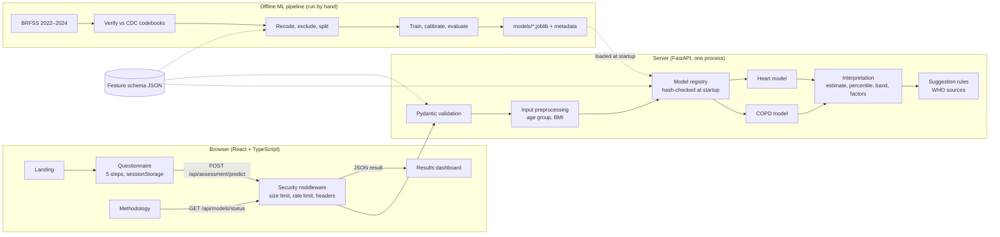
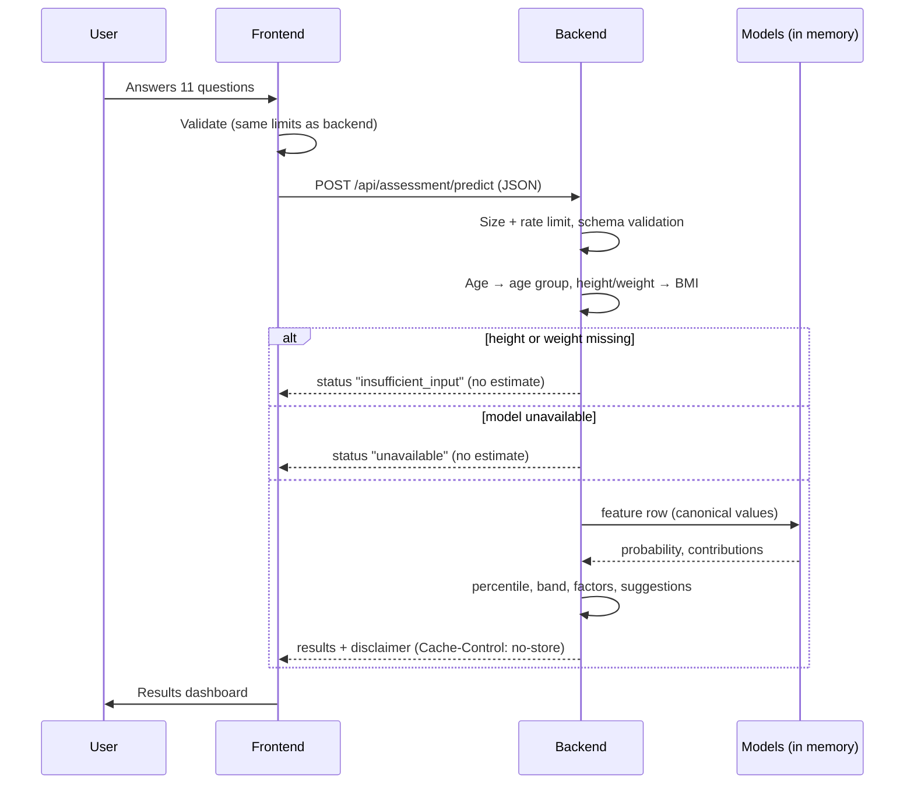

# Vytal architecture

## System overview

## Request sequence

## Key design points

| Point | How |
|---|---|
| One definition of inputs | `ml/feature_definitions/vytal_feature_schema.json` is used by preprocessing, training, the API schema tests and model loading |
| Served numbers equal evaluated numbers | The backend imports `ml/inference/risk_model.py`, the same code used to evaluate the models |
| Honest failure | Missing BMI, missing or tampered model → explicit status, never a number |
| Privacy | No identifiers collected; nothing stored or logged server-side; browser keeps answers in `sessionStorage` only |
| Production | One process serves website and API (`scripts/start_production.ps1`) |

## Folders

See the root `README.md` and each folder's `README.md` (`backend/`, `frontend/`, `ml/`, `models/`, `datasets/`, `tests/`).
