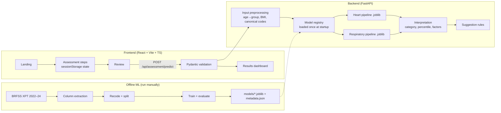

# VYTAL — MASTER IMPLEMENTATION PLAN (approved, Revision 1)

| Revision | Date | Change |
|---|---|---|
| 0 | 2026-10-26 | Original plan approved in Plan Mode (Tasks 1–13). Task 1 completed under it. |
| 1 | 2026-10-26 | User direction update: Vytal is a maintainable, deployment-ready application, not an educational prototype. Adds engineering autonomy rules, production-readiness work (security, privacy, production build, CI, model cards, end-to-end browser tests). Clinical-validation claims remain prohibited. Details in "Revision 1" below; affected task sections are marked **[R1]**. |

## REVISION 1: DIRECTION UPDATE (2026-10-26)

### R1.1 Product vision
Vytal is a personalized health-risk assessment web application intended to become a complete, maintainable, deployment-ready software system: polished frontend, working backend, real data processing, genuine model inference, meaningful evaluation, documented limitations, privacy and security controls, automated tests, and a repeatable deployment process. It is not a static demo, mock dashboard or set of disconnected components; each task must leave more of the system genuinely working.

Vytal must **never** be described as clinically validated, medically certified or suitable for clinical decision-making. No such evidence or approval exists. "Production-oriented engineering" describes software quality, not clinical status. User-facing copy drops the "educational prototype" label but keeps a clear "not a diagnosis, not clinically validated" statement.

The 7-day schedule stands. If time runs short, a smaller genuinely working system beats a larger superficial one.

### R1.2 Engineering autonomy (applies to all remaining tasks)
Authorized without per-step approval: reading/creating/editing/moving project files; maintaining the directory structure; installing/updating project-local dependencies; running scripts, data inspection, preprocessing, training, evaluation, builds, linting and tests; starting/stopping processes the agent created; downloading the official public BRFSS files and public dependencies; fixing errors; meaningful Git commits; pushing verified commits to `origin/main` after checking for secrets, private data and large artifacts; maintaining all tracking documents; reasonable implementation decisions and justified refactors.

Not allowed without explicit approval: deleting unrelated files or touching other projects; broad system or global configuration changes; exposing credentials or personal data; committing raw data, `.env`, virtual environments or build folders; force-push, branch deletion or history rewriting; anything that costs money; public deployment, DNS, production infrastructure or account-permission changes. Never claim an install, test, download, training run, push or deployment succeeded unless the result was observed.

Ask the user only for decisions that materially affect privacy, security, cost, irreversibility, external publication, legal obligations, or a genuine product trade-off that evidence cannot settle. When asking: state the exact action, why, the risk, and the safest alternative, and continue independent work meanwhile.

### R1.3 Production-readiness additions (folded into the tasks below)
| Area | Addition | Task |
|---|---|---|
| Security | Strict request schemas (`extra="forbid"`), request body size limit, security headers (CSP, `X-Content-Type-Options`, `Referrer-Policy`, `frame-ancestors`), CORS from environment config, generic error bodies, OpenAPI docs switchable off in production | 6, 12 |
| Privacy | No name or identifying fields collected; no storage of responses; no request-body logging; `Cache-Control: no-store` on assessment responses; in-app privacy notice; "Start over" clears session storage | 6, 9, 10 |
| Model integrity | SHA-256 of each `.joblib` recorded in its metadata and verified before loading (joblib uses pickle, so only verified repository artifacts are loaded) | 4–6 |
| Evaluation | Subgroup metrics by sex and age band (bias check); survey-weighted prevalence (`_LLCPWT`, divided by number of pooled years per CDC guidance) reported beside unweighted prevalence | 3–5 |
| Documentation | Model card per model; data dictionary; deployment guide; privacy and limitations page | 4–5, 11, 13 |
| Production build | One-process production mode: FastAPI serves the built frontend from `frontend/dist` on the same origin; `scripts/build_release.ps1`, `scripts/start_production.ps1`; configuration through environment variables | 12 |
| Deployment | `Dockerfile` provided; marked verified only if Docker is available on the machine and the image is actually built and run. **No public deployment without explicit approval.** | 12 |
| CI | GitHub Actions workflow: Python tests (data-dependent tests skip without data), frontend lint, unit tests and build. Uses GitHub's free allowance; no payment method involved | 12 |
| End-to-end tests | Playwright driving the already-installed Microsoft Edge (`channel: "msedge"`), so no browser download; replaces the earlier "no Playwright" decision | 11–12 |
| Dependency hygiene | `pip-audit` and `npm audit` run and results recorded | 12 |

### R1.4 Heart model training years (resolved by user, subject to verification)
User decision (2026-10-26), superseding D-003: **pool BRFSS 2022, 2023 and 2024 for the heart model**, using only risk-factor and health-history features whose meaning, coding and availability are verified in all three years. Blood pressure and cholesterol are excluded only if the files show they are not consistently available; this is checked, not assumed. Before finalizing, Task 2 inspects target definitions, feature availability, answer coding, missing-value conventions and sample counts per year. If pooling shows incompatible definitions or serious data-quality problems, **stop and report the evidence** before changing approach. Reproducibility and proper evaluation outrank row count. Recorded as D-022. Consequence: both models now use the same three years, so one extraction step serves both.

### R1.5 Interpretation, security, quality gates and deployment (user sections 7–13)
- **Interpretation.** The UI and docs state for each model: the exact outcome (survey-reported condition status, not future onset), the population (US adults responding to BRFSS 2022–2024), and the difference between a *model score*, a *calibrated probability*, *survey prevalence* and *clinical risk* (which Vytal does not estimate). Categories are relative bands (D-010) with their rationale, limitations and validation (how often people in each band actually reported the condition in the test set) documented and shown. Suggestions never prescribe treatment or determine a condition.
- **Security and privacy review items:** input validation and safe errors; CORS/allowed origins from environment; secrets via environment only (none currently needed); pinned dependencies and reproducible installs; logging that never contains health inputs; data minimization, no storage, consent wording; artifact integrity and load failures; liveness (`/api/health`) and readiness (`/api/health/ready`, true only when models load) checks; **rate limiting**: a small in-process limiter on the predict endpoint, configurable, plus documented reverse-proxy limits for public deployment; HTTPS and hosting configuration documented for any future public deployment; accessibility, browser compatibility and responsiveness. A local app running successfully is never described as production-secure.
- **Quality gates per phase (run and report real results):** backend unit and API tests; data validation and preprocessing tests; model evaluation and feature-schema compatibility checks; frontend lint and production build; API/frontend integration tests; end-to-end workflow tests; error-path and invalid-input tests; model-loading and missing-model tests. Never weaken assertions to pass.
- **"Deployable" requires** a fresh clone following the documented instructions and the essential workflow passing end to end (Task 13).
- **Deployment deliverables (Tasks 12–13):** exact setup and run commands; environment-variable documentation; repeatable artifact generation; frontend build and backend production-run instructions; a deployment configuration for a free hosting target only when justified (no account creation, no public deploy without approval); health/readiness checks; deployment checklist, troubleshooting and **rollback** instructions (redeploy previous Git tag and model version); a clear list of what is still required before public or clinical use.
- **Visual identity:** navy/charcoal foundation, controlled teal/cyan accents (violet only as a minor secondary), restrained glass, real backend values only, sample content labelled.
- **Phase reports** must include: work and files changed, commands executed, actual test/build results, dataset/model status, known issues, Git commit/push status, exact next actions, decisions requiring approval.
- **Execution:** proceed autonomously task to task after Task 2's data inspection; at the end of each phase give the user a short plain-language summary (what works, what was tested, what remains, what to do next).

---

## EXECUTION INSTRUCTIONS
- Work proceeds task by task under the autonomy rules in R1.2. The agent continues to the next task without waiting for per-step approval, except at the permission boundary, at a documented stop condition (e.g. Task 2's blood-pressure/cholesterol check), or when the user has asked to pause.
- Task 1 is complete (commit `e77e07f` and follow-ups). Task 1 originally saved this plan verbatim.
- Workspace root is `c:\vytal_ty` (Windows 11, PowerShell, 8 GB RAM, CPU only). It was empty at planning time. Project files go directly in the root (no nested `vytal/` folder).
- Use `.venv\Scripts\python.exe` directly (avoids PowerShell execution-policy issues).
- User has Python, Node and Git installed; the agent may install project packages itself. Verify versions (Python >=3.10, Node >=18). If `git config user.name/email` are unset, ask the user for values.
- GitHub remote: `https://github.com/aryanbhowar/Vytal.git`, branch `main`. First push may require the user's browser sign-in. Never claim a push succeeded unless it did; record actual commit hash and push status.
- Per task protocol — start: read `PROJECT_STATUS.md` and the relevant plan section. End: run the task's tests; update `docs/phase_reports/PHASE_N_REPORT.md` (sections: objective, work completed, files, decisions+reasons, commands executed, actual tests+outcomes, errors/limitations, dataset/model status, git commit+push status, exact next steps), `PROJECT_STATUS.md`, `CHANGELOG.md`, the relevant section of `docs/VIVA_NOTES.md` (what the module does, why, inputs, outputs, connections, how to explain in viva); check `git status` for secrets/data; conventional commit; push.
- Phase reports (user requirement, added 2026-10-26): detailed, plain beginner-level language, every technical term explained, easy to explain in a viva. Follow the structure in `docs/phase_reports/README.md`.
- Never fabricate datasets, metrics, test results, or predictions. Mock data only in clearly labelled test fixtures.
- Phase mapping: Phase 1 = Tasks 1–2 (Day 1); Phase 2 = Tasks 3–5 (Day 2); Phase 3 = Tasks 6–7 (Day 3); Phase 4 = Tasks 8–9 (Day 4); Phase 5 = Tasks 10–11 (Day 5); Phase 6 = Task 12 (Day 6); Phase 7 = Task 13 (Day 7).

---

## Problem Statement
**[R1]** Build, in 7 days, a maintainable, deployment-ready personalized health-risk assessment application that runs locally without paid services (original wording: "a locally runnable educational health-risk-awareness prototype"). A user completes a questionnaire; a FastAPI backend validates it, maps it to model features, and runs two separately trained, honestly evaluated scikit-learn models for **self-reported coronary heart disease / heart attack** and **self-reported COPD**. A glassmorphism dashboard shows categories, contributing factors, rule-based suggestions, and limitations. Results are framed as associations with a reported condition in survey data, never as diagnosis or future-onset prediction.

## Requirements (agreed with user)
| Topic | Decision |
|---|---|
| Heart model data | ~~BRFSS 2023 only~~ **[R1]** BRFSS **2022 + 2023 + 2024 pooled**, only features verified compatible across all three years (R1.4, D-022) |
| Respiratory model data | BRFSS **2024 baseline + 2023 + 2022**, harmonized per year |
| Model inputs | Risk factors and health history only (no general health, difficulty walking, physical/mental unhealthy days) |
| Result display | Category + model estimate + survey average; probabilities shown only after calibration check |
| Sources | Official BRFSS codebooks, scikit-learn docs, CDC/WHO public guidance |
| GitHub | `https://github.com/aryanbhowar/Vytal.git`, branch `main` |
| Out of scope | Accounts, auth, database, cloud inference, LLMs, wearables, payment, persistent health profiles |

## Background (research findings)
- Zenodo "BRFSS 2020 Heart Disease (Cleaned)" (= Kaggle heart_2020_cleaned, 319,795 rows, 18 cols, 23.3 MB) is **rejected**: 2020 data; documentation contradicts itself (description says CHD-or-MI, table maps to `CVDINFR4`; BMI attributed to categorical `_BMI5CAT` but values continuous); unverifiable recodes; no COPD target. Document it in DATA_SOURCES.md as a considered alternative.
- Raw BRFSS LLCP files contain both targets: `_MICHD` (calculated: ever reported CHD or MI) and `CHCCOPD3` (ever told COPD, emphysema or chronic bronchitis). ~400k rows/year; XPT ~1 GB unzipped. Read only required columns in chunks (`pyreadstat.read_xport(usecols=...)`, fallback `pandas.read_sas(format="xport", chunksize=...)`).
- CDC returned HTTP 403 to automated fetching during planning. Download script must send a browser User-Agent; fallback is manual browser download of `LLCP{year}XPT.zip` into `datasets/raw/` (candidate URL pattern `https://www.cdc.gov/brfss/annual_data/{year}/files/LLCP{year}XPT.zip`; verify).
- `BPHIGH6`/`TOLDHI3` are believed to be odd-year rotating questions — verify from actual file columns in Task 2. `TOLDHI3` is only asked if cholesterol was ever checked (`CHOLCHK3`); skip-pattern missingness must not be treated as "no".
- BRFSS is cross-sectional (different respondents each year), so pooling years does not create repeated observations. Population is **US adults** — generalizability limitation; note WHO's lower BMI cut-offs for Asian populations.
- Prevalence of both targets is expected to be single-digit %. `class_weight="balanced"` distorts probabilities, so deployed models are unweighted; imbalance handled through threshold selection for reporting metrics.

---

## Proposed Solution

### 1. Architecture

Shared contract: `ml/feature_definitions/vytal_feature_schema.json` defines each model feature, its canonical category values (e.g. `smoking_status: current_daily | current_some_days | former | never`), source BRFSS variables, and which model uses it. Training maps BRFSS codes → canonical values; the API accepts the same canonical values; the saved sklearn `Pipeline` contains encoders. A consistency test asserts schema = API enums = fitted encoder categories.

### 2. Directory structure
```
c:\vytal_ty\
├─ frontend/  src/{components/{layout,common,form,results}, pages, context, hooks,
│             services, config, types, utils, styles, test/fixtures}, package.json, vite.config.ts, README.md
├─ backend/   app/{api, schemas, services, core, main.py}, requirements.txt, README.md
├─ ml/        feature_definitions/, preprocessing/, training/, evaluation/, requirements.txt, README.md
├─ datasets/  raw/ (ignored) interim/ (ignored) processed/ (CSVs ignored, *_summary.json committed)
│             DATA_SOURCES.md, README.md
├─ models/    heart/, respiratory/ (small .joblib + metadata.json, committed), README.md
├─ tests/     unit/, integration/, data/, README.md
├─ docs/      architecture/, datasets/, model_evaluation/, phase_reports/, implementation/,
│             decisions/DECISION_LOG.md, VIVA_NOTES.md, PROJECT_DOCUMENTATION.md, DEMO_SCRIPT.md
├─ scripts/   check_environment.ps1, start_dev.ps1, run_demo_profiles.py
├─ .gitignore  .env.example  README.md  PROJECT_STATUS.md  CHANGELOG.md
└─ requirements-dev.txt (pytest, httpx)
```
Create folders only when a task puts a file in them. One root `.venv` serves backend and ML. Pin scikit-learn version (joblib artifact compatibility). Commit small model artifacts so the app runs after clone; never commit raw/interim/processed CSV data.

### 3. Dataset strategy
Feature acceptance criteria: present with same meaning/coding in every year its model uses; acceptable missingness after excluding refused/blank (report rates); collectable plainly via questionnaire; not a symptom/current-health-status variable; not the other model's target.

Candidate features (confirm in Task 2, finalize in decision log — do not treat as final):
| Feature (canonical) | BRFSS candidate | Heart (2023) | Respiratory (2022–24) |
|---|---|---|---|
| age_group (13 five-year bands) | `_AGEG5YR` | ✓ | ✓ |
| sex | `SEXVAR` | ✓ | ✓ |
| bmi (continuous) | `_BMI5` ÷ 100 | ✓ | ✓ |
| smoking_status (4 levels) | `_SMOKER3` | ✓ | ✓ |
| physical_activity_past_30_days | `EXERANY2` | ✓ | ✓ |
| diabetes_status | `DIABETE4` | ✓ | ✓ |
| high_blood_pressure | `BPHIGH6` | ✓ | – |
| cholesterol_status (told high / not told / never checked or unsure) | `CHOLCHK3` + `TOLDHI3` | ✓ | – |
| heavy_alcohol_use | `_RFDRHV*` (verify year name) | ✓ if verified | – |
| stroke_history, kidney_disease_history | `CVDSTRK3`, `CHCKDNY2` | ✓ | – |
| asthma_history | `ASTHMA3` | – | ✓ (document asthma/COPD overlap) |
| ecigarette_use | `ECIGNOW*` / `_CURECI*` | – | ✓ if harmonizable |
| **Target** | `_MICHD` (1 yes, 2 no) | ✓ | – |
| **Target** | `CHCCOPD3` (1 yes, 2 no) | – | ✓ |
Excluded by design: race, income, education (fairness, not needed for lifestyle-awareness scope).

Cleaning rules: drop rows with target don't-know/refused/missing; drop refused/blank feature values (report counts); keep "don't know" as a category only where it is a genuine survey response with enough rows; never map skip-pattern missing to "no"; do **not** drop duplicate rows (identical low-dimensional profiles from different respondents are legitimate — document); no survey weights in training (prevalence reported as unweighted, documented); survey year is not a feature. Merge sparse categories (e.g. diabetes during pregnancy only) only with documented rationale.

Splits: stratified 70/15/15 train/validation/test, `random_state=42`. Respiratory supplementary temporal check: train on 2022+2023 train portion, test on 2024 test portion (report only, not deployed).

Outputs: `datasets/processed/heart_mi_chd_brfss2023.csv`, `datasets/processed/respiratory_copd_brfss2022_2024.csv`, `*_summary.json` (counts, prevalence, missingness, drop steps). `DATA_SOURCES.md`: publisher, URLs, year, public-domain US government data + citation, target definitions, features, preprocessing, limitations.

### 4. ML workflow
- Pipeline: `ColumnTransformer` (`OneHotEncoder(handle_unknown="error")` for categoricals, `StandardScaler` for BMI) → `LogisticRegression` (unweighted, sufficient max_iter).
- Comparison model: `HistGradientBoostingClassifier`, reported only. **Logistic Regression is deployed** for exact, defensible explanations (recorded in decision log).
- Metrics on test set (used once): ROC-AUC, PR-AUC, Brier score, calibration curve; precision, recall, specificity, F1, confusion matrix at threshold chosen on **validation** (max F1). Include prevalence-only baseline for context.
- Calibration: if validation calibration is poor, fit `CalibratedClassifierCV(method="isotonic", cv="prefit")` on validation; document which.
- Presentation bands from user's percentile among training-set predictions: Low <50th, Moderate 50–75th, Elevated 75–90th, High ≥90th. Cut-offs in `ml/training/model_training_config.py`, copied into metadata. Labelled "compared with survey respondents", never clinical thresholds.
- Artifacts: `models/heart/heart_logreg_v1.joblib` + `heart_logreg_v1_metadata.json` (version, training years, target definition, features+categories, sklearn version, training prevalence, 101 score quantiles, band cut-offs, encoded-feature training means, test metrics, calibration method). Same for respiratory.
- Reports: `docs/model_evaluation/heart_model_evaluation_report.md`, `respiratory_model_evaluation_report.md`, with matplotlib PNG ROC/PR/calibration plots.

### 5. Explanations
Per feature contribution = Σ coefᵢ × (xᵢ − training mean of xᵢ) over that feature's encoded columns, in log-odds. Contributions + log-odds at mean = user score exactly (linear-model SHAP equivalent under feature independence). Show top 5 by absolute value as "raised / lowered the estimate compared with an average respondent", never as % risk. Mark modifiable vs non-modifiable. State association, not causation. If calibration applied, document that factors explain the pre-calibration score.

### 6. Backend API contract
- `GET /api/health` → `{status:"ok", app:"Vytal", version}`
- `GET /api/models/status` → `{models:[{model_id, available, model_version, training_years, target_description}]}`
- `POST /api/assessment/predict`
  - Request: `age_years` (18–120), `sex`, `height_cm` (100–250, nullable), `weight_kg` (25–300, nullable), `smoking_status`, `physical_activity_past_30_days`, `diabetes_status`, `high_blood_pressure`, `cholesterol_status`, `heavy_alcohol_use`, `stroke_history`, `kidney_disease_history`, `asthma_history`, `ecigarette_use` (final list per Task 2 decision log); enums use canonical values.
  - Response: `profile_summary` (submitted values; BMI `{value, who_category, source:"derived from height and weight"}`), `results[]` per model `{model_id, status:"ok"|"unavailable"|"insufficient_input", estimated_probability, survey_prevalence, percentile, category, category_explanation, contributing_factors[], limitations[], model_version}`, `suggestions[] {id, theme, title, body, triggered_by, source_name, source_url}`, `disclaimer`.
  - Errors: 422 friendly `{errors:[{field, message}]}`; one model missing → 200 with that model `unavailable`; both missing → 503; no height/weight → `insufficient_input` (BMI required, never imputed); BMI outside training range (≈12–70) rejected with message; 500 generic message, no paths/stack traces. No request-body logging, no storage.
- Services: `input_preprocessing_service.py`, `model_registry.py` (FastAPI lifespan load), `risk_prediction_service.py` (generic, config per model — avoids duplicate heart/respiratory services), `result_interpretation_service.py`, `factor_explanation_service.py`, `health_suggestion_rules.py`, `suggestion_service.py`. Core: `config.py`, `errors.py`.

### 7. Suggestions
`backend/app/services/health_suggestion_rules.py`: list of rule dataclasses `{id, condition(profile, results), theme, text, source}`. Rules: current smoking/e-cig → cessation support; no activity → WHO 150–300 min moderate/week; BMI ≥25 or <18.5 → weight-management support / professional advice; reported diabetes / high BP / high cholesterol → keep regular clinician reviews; Elevated/High category → consider a professional check-up; always-on urgent-symptoms notice (chest pain, severe breathlessness → seek care now regardless of result). No medication, diets, supplements, or US-specific hotlines. One unit test per rule.

### 8. Frontend
- Routes: `/` Landing; `/assessment` 5 steps (About you; Body measurements with cm/kg ↔ ft-in/lb toggle and live BMI preview labelled "derived"; Lifestyle; Health history; Review); `/results`; `/methodology`.
- State: `AssessmentContext` (`useReducer` + `sessionStorage`; clears on tab close). `/results` without result → redirect to Review.
- Components: layout `AppNavigation`; common `GlassCard`, `Button`, `DisclaimerBanner`, `LoadingState`, `ErrorState`; form `NumberField`, `RadioCardGroup`, `StepProgress`; results `ProfileSummary`, `RiskResultCard` (percentile band bar), `ContributionChart` (Recharts diverging bar), `SuggestionCard`, `ModelUnavailableNotice`.
- Services `apiClient.ts`, `assessmentService.ts`; config `assessmentQuestions.ts`; utils `bmiCalculation.ts`, `unitConversion.ts`, `formValidation.ts`; types `assessment.ts`. Vite proxy `/api` → `http://127.0.0.1:8000`.
- Dependencies: react-router-dom, recharts, lucide-react, @fontsource/inter; dev: vitest, @testing-library/react, jsdom.
- Design tokens (`styles/tokens.css`): bg `#0B1020`/`#111733`; accents violet `#8B5CF6`, blue `#3B82F6`, teal `#2DD4BF`; text `#E8ECF8`, muted `#9AA3C0`; glass `rgba(255,255,255,.06)` + border `rgba(255,255,255,.12)` + 16px blur; radii 12/20/28; 4px spacing scale; durations 150/250/400 ms; category colours teal/blue/amber/rose. Self-hosted Inter. WCAG AA contrast; opaque fallback without `backdrop-filter`; limit blurred layers (integrated GPU); `prefers-reduced-motion` respected; visible focus rings; check widths 1440/1024/768/375.

### 9. Testing
- pytest `tests/unit` (recode maps, BMI, age grouping, interpretation, contributions sum, suggestion rules), `tests/data` (processed columns, 0/1 target, no NaN features, no target-derived columns, split separation), `tests/integration` (TestClient valid/invalid/unavailable, schema, no stack-trace leakage, backend-vs-pipeline consistency).
- Vitest + Testing Library: validation utils, step navigation persistence, results rendering from fixtures clearly labelled TEST FIXTURE.
- E2E: `scripts/run_demo_profiles.py` posts 4 documented profiles to live backend; manual checklist in `docs/DEMO_SCRIPT.md`. **[R1]** Plus Playwright browser tests (`frontend/e2e/`) using the installed Microsoft Edge (`channel: "msedge"`, no browser download): full questionnaire → results flow against the real backend and models, error state with backend stopped, keyboard-only navigation, and widths 1440/768/375.

### 10. Git and tracking
Tracking files: `PROJECT_STATUS.md` (objective, phase, completion estimate + method, completed/partial/not-started, blockers, frontend/backend/dataset/heart/respiratory/test status, latest working commands, last known-good commit, next three actions, decisions needing user input; never mark complete because a file exists), `CHANGELOG.md`, `docs/phase_reports/PHASE_1..7_REPORT.md`, `docs/VIVA_NOTES.md`, `README.md`, `docs/decisions/DECISION_LOG.md`. Track the brief's 24 final success criteria in PROJECT_STATUS.md with honest status. Commit message examples: `chore: initialize Vytal project structure`, `data: add verified BRFSS variable inspection`, `ml: train and evaluate heart baseline model`, `backend: implement assessment prediction API`, `frontend: build health assessment interface`, `integration: connect assessment workflow`, `docs: complete project implementation notes`.

---

## Task Breakdown

**Task 1: Foundation and runnable skeleton (Day 1)**
Objective: a repo that starts backend and frontend which communicate, with tracking files in place.
Guidance: save this plan to `docs/implementation/MASTER_IMPLEMENTATION_PLAN.md`; `scripts/check_environment.ps1` (python/node/npm/git versions); `python -m venv .venv`; `backend/requirements.txt` (fastapi, uvicorn[standard], pydantic, plus pinned scikit-learn, pandas, numpy, joblib for later), `requirements-dev.txt` (pytest, httpx); install; `backend/app/main.py` with `GET /api/health` via `backend/app/api/health_routes.py` and `core/config.py`; `pytest.ini`/`pyproject` config so tests import `app` from `backend`; `npm create vite@latest frontend -- --template react-ts`, `npm install`, Vite proxy, minimal page fetching `/api/health` and showing "API connected" (or an error state); `.gitignore` (.venv, node_modules, dist, __pycache__, .pytest_cache, .env, datasets/raw, datasets/interim, datasets/processed/*.csv, *.parquet, *.zip, *.XPT); `.env.example`; `README.md` with run commands; `PROJECT_STATUS.md`, `CHANGELOG.md`, `docs/decisions/DECISION_LOG.md` (record decisions in this plan), `docs/VIVA_NOTES.md` skeleton, `docs/phase_reports/PHASE_1_REPORT.md` (in progress); `git init`, `git branch -M main`, `git remote add origin https://github.com/aryanbhowar/Vytal.git`, commit, `git push -u origin main`.
Tests: `tests/integration/test_health_api.py` passes; `npm run build` succeeds.
Demo: `.venv\Scripts\python -m uvicorn app.main:app --app-dir backend --reload` + `npm run dev`; browser at localhost:5173 shows "API connected"; repo visible on GitHub.

**Task 2: BRFSS acquisition and variable verification (Day 1)**
Objective: confirm targets and features in 2022/2023/2024 files from the actual data.
**[R1]** Also: inspect heart candidate variables (including `BPHIGH6`, `TOLDHI3`, `CHOLCHK3`) in 2022, 2023 and 2024, record usage terms, refusal/don't-know codes, survey-design variables (`_LLCPWT`, `_STSTR`, `_PSU`) and their implications, and produce the evidence needed to settle D-022.
Guidance: `ml/requirements.txt` (pyreadstat, pyarrow, matplotlib); `ml/preprocessing/download_brfss_data.py` (browser UA, size check, unzip to datasets/raw/, print manual instructions on failure); `inspect_brfss_variables.py` (column metadata + value counts of candidate vars only, low memory); `docs/datasets/brfss_variable_availability.md` (variable × year matrix with codebook code tables); finalize feature lists in decision log — **if 2023 lacks BP or cholesterol, stop and ask the user**; first `datasets/DATA_SOURCES.md` + `datasets/README.md` including Zenodo rejection rationale. Complete PHASE_1_REPORT.
Tests: data test that required targets exist in each needed year.
Demo: inspection script prints availability table.

**Task 3: Reproducible preprocessing (Day 2)**
Objective: model-ready CSVs for both outcomes with documented step counts.
Guidance: `ml/feature_definitions/vytal_feature_schema.json`, `brfss_variable_maps.py` (per-year code→canonical maps); `ml/preprocessing/brfss_data_extraction.py` (chunked selected columns → `datasets/interim/*.parquet`), `recode_functions.py`, `heart_data_preprocessing.py`, `respiratory_data_preprocessing.py`, `dataset_split.py` (`split` column); summary JSON files.
Tests: unit tests per recode function using tiny synthetic rows labelled as synthetic; data tests on outputs.
Demo: `python -m ml.preprocessing.heart_data_preprocessing` prints counts, prevalence, drop reasons.

**Task 4: Heart model training and evaluation (Day 2)**
Objective: evaluated, saved heart pipeline + metadata.
Guidance: `ml/training/model_training_config.py`, generic `train_binary_risk_model.py` (fit, validation threshold, calibration check, single test evaluation, HGB comparison), `heart_model_training.py`; `ml/evaluation/evaluation_metrics.py`, `evaluation_report_writer.py`.
Tests: artifact loads; schema-valid row → predict_proba shape (1,2) in [0,1]; metadata categories = schema; metrics computed from test split only.
Demo: `python -m ml.training.heart_model_training` writes model, metadata, and report with real numbers.
**[R1]** Also: subgroup metrics (sex, age band); weighted and unweighted prevalence; SHA-256 of the artifact in metadata; `docs/model_evaluation/heart_model_card.md` (intended use, out-of-scope uses, data, metrics, subgroup results, limitations, "not clinically validated"). Task 5 does the same for respiratory.

**Task 5: Respiratory model training and evaluation (Day 2–3)**
Objective: same for COPD on pooled 2022–2024.
Guidance: reuse generic trainer with respiratory config; add temporal check section.
Tests: same artifact tests. Demo: both models + reports exist with metrics and limitations. Complete PHASE_2_REPORT.

**Task 6: Backend prediction pipeline (Day 3)**
Objective: `POST /api/assessment/predict` returns real model output with categories and factors.
Guidance: request/response schemas; input preprocessing (age→group, BMI with range checks); model registry at startup + `GET /api/models/status`; prediction, interpretation, factor services; error handlers.
Tests: BMI/age-group/band unit tests; contributions sum to log-odds; integration: valid, out-of-range (422), bad enum (422), missing height (insufficient_input), missing artifact (monkeypatched → unavailable / 503), no stack trace in 500; backend-vs-pipeline consistency.
Demo: Swagger at localhost:8000/docs returns both results for a sample profile.
**[R1]** Also: `extra="forbid"` on request models; body size limit; security-header middleware; `Cache-Control: no-store` on predict; artifact hash verified before load (mismatch → model `unavailable`, logged without paths to the user); tests for each.

**Task 7: Health suggestion rules (Day 3)**
Objective: deterministic, sourced suggestions in the predict response.
Guidance: rules module, `suggestion_service.py`, always-on urgent-symptoms notice; wire into predict.
Tests: one per rule (fires/doesn't fire); no medication terms in any text.
Demo: inactive smoker profile gets cessation + activity suggestions with sources. Complete PHASE_3_REPORT.

**Task 8: Design system and landing page (Day 4)**
Objective: reusable glass design system and polished landing page.
Guidance: `tokens.css`, `glass.css`, `layout.css`, `global.css`; `GlassCard`, `Button`, `AppNavigation`, `DisclaimerBanner`; React Router; landing CTA → `/assessment` (placeholder until Task 9); install frontend deps and Vitest setup.
Tests: landing renders disclaimer; CTA links to `/assessment`; `npm run build`.
Demo: landing page at desktop and mobile widths; reduced motion respected.

**Task 9: Assessment questionnaire with submission (Day 4)**
Objective: 5-step validated, persisted questionnaire submitting to the real API.
Guidance: `assessmentQuestions.ts` (canonical values), `AssessmentContext` + sessionStorage, form components, `formValidation.ts`, `unitConversion.ts`, BMI preview, Review step, `apiClient.ts` + `assessmentService.ts`, loading/error states; on success navigate to `/results` with a minimal summary.
Tests: validation utils (ranges, required, conversion); step navigation preserves answers; API failure shows error state.
Demo: fill form, navigate back/forward without loss, submit, see real backend probabilities. Complete PHASE_4_REPORT.

**Task 10: Results dashboard (Day 5)**
Objective: complete results experience.
Guidance: `ProfileSummary` (measured vs derived), two `RiskResultCard`s (category, estimate, survey average, percentile band), `ContributionChart`, `SuggestionCard`s, `ModelUnavailableNotice`, limitations section, Revise answers / Start over.
Tests: render from labelled fixtures for ok/unavailable/insufficient_input; Start over clears session.
Demo: real submission → full dashboard; backend started without one model → honest notice.

**Task 11: Methodology page and end-to-end verification (Day 5)**
Objective: transparent methodology page and verified full workflow.
Guidance: `/methodology` (data, targets, features, metrics from metadata via `/api/models/status`, bands, limitations); `scripts/run_demo_profiles.py` with 4 documented profiles (low-factor, smoker, heart-history-heavy, missing height); manual checklist at 4 widths; keyboard-only pass; fix layout issues.
Tests: demo script asserts schema and finite outputs.
Demo: examiner can follow full flow. Complete PHASE_5_REPORT.

**Task 12: Stability, production build and deployment readiness (Day 6)** **[R1]**
Objective: repeatable demo and a repeatable production build.
Guidance: run full pytest + Vitest + Playwright, fix failures; `scripts/start_dev.ps1` launches both servers; determinism check; `docs/DEMO_SCRIPT.md`; **[R1]** production mode where FastAPI serves `frontend/dist` (`scripts/build_release.ps1`, `scripts/start_production.ps1`, env-driven config, docs toggle); `Dockerfile` (verified only if Docker present); `.github/workflows/ci.yml`; `pip-audit` + `npm audit` recorded; `docs/deployment/DEPLOYMENT.md` (local production run, container, hosting options that would need approval). Freeze architecture.
Tests: all pass from fresh terminal; production mode serves the app and API on one port; CI run result observed on GitHub (or recorded as not observed).
Demo: one command starts app; scripted demo runs twice identically; production build runs locally. Complete PHASE_6_REPORT.

**Task 13: Documentation and handover (Day 7)**
Objective: state recoverable from repo; viva-ready.
Guidance: complete README (setup, run, data prep, training, API, tests, limitations); mermaid diagrams in `docs/architecture/`; `docs/PROJECT_DOCUMENTATION.md`; finalize `VIVA_NOTES.md`; final PROJECT_STATUS with honest status per success criterion; clone repo to a temp folder and follow README exactly, fixing gaps.
Demo: fresh clone runs following README alone. Complete PHASE_7_REPORT.

---

## Risks and fallbacks
| Risk | Fallback |
|---|---|
| CDC blocks scripted download | User downloads 3 zips in browser (document links) |
| 2023 lacks BP/cholesterol | Stop and ask user (options: shared-feature heart model, or 2021) |
| Feature not harmonizable 2022–24 | Drop from respiratory model; record in decision log |
| Poor calibration | Isotonic on validation; if still poor, show category/percentile only and explain |
| Modest performance | Report honestly; never tune on test |
| GitHub auth fails | Keep local commits; record blocker |
| Schedule slip | Priority: runnable app → questionnaire → one real model → honest second-model status → integration → dashboard → docs → optional |
| Blur performance | Reduce blurred layers |

| **[R1]** Docker not installed | Ship the Dockerfile marked "not verified"; local production mode is the verified path |
| **[R1]** Edge/Playwright unavailable | Fall back to the scripted API demo plus a manual browser checklist; record it |

## Decisions made / open
Made: all Requirements table items; LR deployed, HGB comparison only; percentile bands 50/75/90; log-odds contributions; no DB/auth; unweighted training; models committed, data not; single generic prediction service; project at workspace root.
Open (resolved in Task 2): final per-model feature lists, exact per-year variable names, sparse-category merges. **[R1]** Heart model training years (D-022, needs user confirmation).

## Definition of done
A feature is done when its tests pass, its demo works, and documentation is updated. The brief's 24 success criteria are tracked in PROJECT_STATUS.md with actual status.
