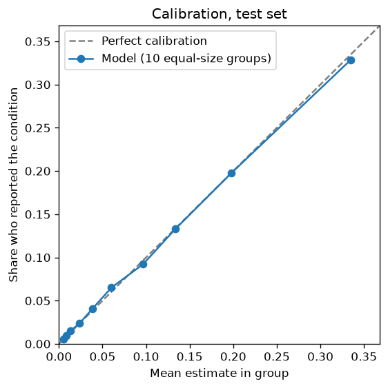
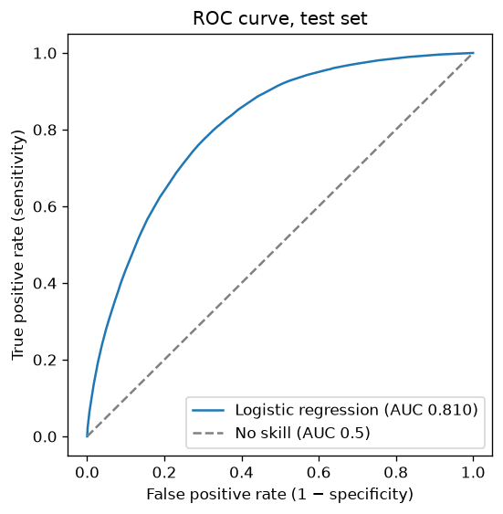
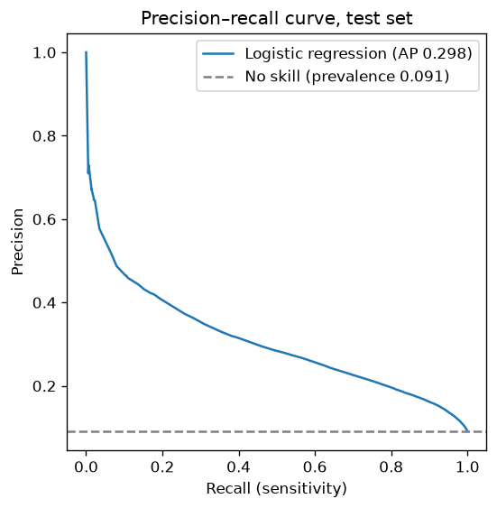

# Model evaluation report: Heart (reported coronary heart disease or heart attack)

_Generated by `ml/training/train_binary_risk_model.py` on 2026-10-27 for model `heart_logreg_v1.joblib` (version 1.0.0). Every number below was computed by the training script; nothing is entered by hand. Re-running training regenerates this file._

## What the model estimates

Ever reported being told by a health professional that they had a heart attack (myocardial infarction) or coronary heart disease (BRFSS _MICHD). The model learns which combinations of answers go with **having reported** the condition in the survey. It does not predict whether a person will develop the condition, and it is not a diagnosis.

## Data and method

| Item | Value |
|---|---|
| Data | CDC BRFSS 2022, 2023, 2024 (pooled, complete cases) |
| Rows | train 791,357 · validation 169,576 · test 169,577 (stratified by outcome and year, seed 42) |
| Outcome rate in training data | 9.11% (unweighted sample) |
| Weighted US adult estimate | 6.72% (CDC survey weights, all respondents with a valid answer) |
| Features | age_group, sex, bmi, smoking_status, physical_activity_past_30_days, diabetes_status, stroke_history, kidney_disease_history |
| Algorithm | Logistic regression (scikit-learn), unweighted |
| BMI form | spline (validation log loss: linear 0.24878, spline 0.24876; lower is better) |
| Calibration | isotonic (fitted on validation) (validation before calibration: ECE 0.83%, slope 1.002) |

The test set was used once, after every choice (BMI form, calibration, threshold) had been made on the validation set.

## Results on the test set

| Metric | Model | Baseline: same estimate for everyone | What it means |
|---|---|---|---|
| ROC-AUC | 0.810 | 0.500 | Chance that a random person who reported the condition gets a higher estimate than a random person who did not |
| ROC-AUC, survey-weighted | 0.831 | 0.500 | The same, weighting respondents to represent US adults |
| PR-AUC (average precision) | 0.298 | 0.091 | Precision averaged over all recall levels; the baseline equals the outcome rate |
| Brier score | 0.0723 | 0.0828 | Mean squared error of the estimates (lower is better) |
| Log loss | 0.2498 | 0.3050 | Penalises confident wrong estimates (lower is better) |
| Expected calibration error | 0.22% | — | Average gap between estimate and observed rate across 10 groups |
| Calibration slope / intercept | 0.972 / -0.051 | — | 1 / 0 is perfect; slope below 1 means estimates are too spread out |

### At the reporting threshold (18.4%, chosen as maximum F1 on validation)

A threshold turns estimates into yes/no flags only so that standard metrics can be reported. **Vytal does not show users a yes/no result.**

| Metric | Value |
|---|---|
| Sensitivity (recall) | 54.4% of people who reported the condition were flagged |
| Specificity | 85.5% of people who did not were not flagged |
| Precision | 27.3% of flagged people had reported the condition |
| F1 | 0.363 |
| Share of people flagged | 18.2% |
| Accuracy (for reference only) | 82.6%; predicting "no" for everyone would score 90.9% |

Confusion matrix (test set):

| | Flagged | Not flagged |
|---|---|---|
| Reported the condition | 8,400 (true positive) | 7,043 (false negative) |
| Did not report it | 22,415 (false positive) | 131,719 (true negative) |

## Class imbalance

Only 9.1% of test respondents reported the condition. That is why accuracy is misleading (saying "no" to everyone is highly accurate) and why precision is modest at any useful sensitivity: even a good ranking flags many people who did not report the condition. The model was trained without class weighting so that its estimates stay on the true scale (D-009); imbalance only affects the reporting threshold.

## Calibration

| Group (by estimate) | People | Mean estimate | Observed rate |
|---|---|---|---|
| 1 | 16,958 | 0.55% | 0.52% |
| 2 | 16,958 | 0.84% | 0.96% |
| 3 | 16,958 | 1.35% | 1.51% |
| 4 | 16,958 | 2.37% | 2.39% |
| 5 | 16,958 | 3.84% | 4.06% |
| 6 | 16,958 | 6.02% | 6.50% |
| 7 | 16,958 | 9.66% | 9.22% |
| 8 | 16,957 | 13.35% | 13.29% |
| 9 | 16,957 | 19.79% | 19.77% |
| 10 | 16,957 | 33.48% | 32.86% |

  

## Presentation bands (what users see)

Bands describe where a person's estimate falls among the **training-set respondents**: Low = below the 50th percentile, Moderate = 50th–75th, Elevated = 75th–90th, High = 90th and above. They are **not clinical risk thresholds**. The table shows how often test-set respondents in each band actually reported the condition.

| Band | Estimate range | Share of test respondents | Observed rate in band | Mean estimate in band |
|---|---|---|---|---|
| Low | below 4.62% | 46.9% | 1.67% | 1.60% |
| Moderate | 4.62%–13.41% | 25.8% | 7.94% | 7.83% |
| Elevated | 13.41%–25.27% | 16.4% | 16.97% | 16.88% |
| High | 25.27% and above | 10.9% | 31.93% | 32.79% |

## Subgroup results (bias check, test set)

| Group | People | Outcome rate | Mean estimate | ROC-AUC | Sensitivity | Specificity | Calibration error |
|---|---|---|---|---|---|---|---|
| sex: female | 86,677 | 7.0% | 7.1% | 0.791 | 39.4% | 90.8% | 0.59% |
| sex: male | 82,900 | 11.3% | 11.2% | 0.812 | 64.1% | 79.6% | 0.31% |
| age: 18-44 | 51,261 | 1.4% | 1.1% | 0.720 | 2.4% | 99.9% | 0.30% |
| age: 45-64 | 54,130 | 7.2% | 6.9% | 0.755 | 31.2% | 93.8% | 0.48% |
| age: 65+ | 64,186 | 16.9% | 17.4% | 0.707 | 66.2% | 63.9% | 0.55% |
| survey_year: 2022 | 55,547 | 9.2% | 9.0% | 0.809 | 53.5% | 86.0% | 0.31% |
| survey_year: 2023 | 55,881 | 8.6% | 9.1% | 0.815 | 55.4% | 85.4% | 0.54% |
| survey_year: 2024 | 58,149 | 9.5% | 9.3% | 0.806 | 54.3% | 85.0% | 0.37% |

ROC-AUC within an age group is lower than overall because age itself is a strong signal; within a group the model must rely on the other answers. Sensitivity differs by group mainly because outcome rates differ (one threshold flags more people in higher-rate groups).

## Which answers matter most (test set)

Mean absolute contribution to the log-odds score per person, using the same method as the explanations shown to users. This is association within this model, not cause.

| Feature | Mean absolute contribution |
|---|---|
| Age | 0.929 |
| Sex | 0.310 |
| Cigarette smoking | 0.243 |
| Ever told by a health professional that you have diabetes | 0.171 |
| Body mass index (from height and weight) | 0.107 |
| Any physical activity or exercise outside work in the past 30 days | 0.105 |
| Ever told you had a stroke | 0.104 |
| Ever told you had kidney disease (not stones, bladder infection or incontinence) | 0.077 |

## Robustness checks (reported only)

| Check | ROC-AUC | PR-AUC | Brier | Calibration error |
|---|---|---|---|---|
| Deployed model, test set | 0.810 | 0.298 | 0.0723 | 0.22% |
| Trained on 2022–2023 only, tested on 2024 (58,149 rows) | 0.806 | 0.313 | 0.0752 | 0.77% |
| Gradient boosting comparison (not deployed) | 0.813 | 0.309 | 0.0719 | 0.17% |

Logistic regression is deployed because its per-answer explanations are exact and easy to check (D-008). The comparison shows how much accuracy, if any, that choice costs.

## Limitations

- Self-reported, "ever told" outcomes; undiagnosed people count as "no".
- Cross-sectional data: answers such as smoking may have changed after diagnosis. Associations, not causes.
- US adults in a telephone survey; may not transfer to other populations.
- Complete-case data (about 15–19% of respondents excluded for unusable answers).
- Metrics treat respondents as independent and ignore the survey's strata and clusters.
- Not clinically validated; not for diagnosis or treatment decisions.
- Blood pressure and cholesterol were not available across 2022–2024 and are not inputs.
