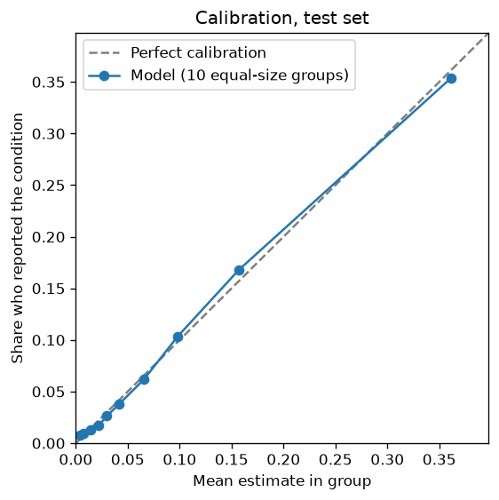
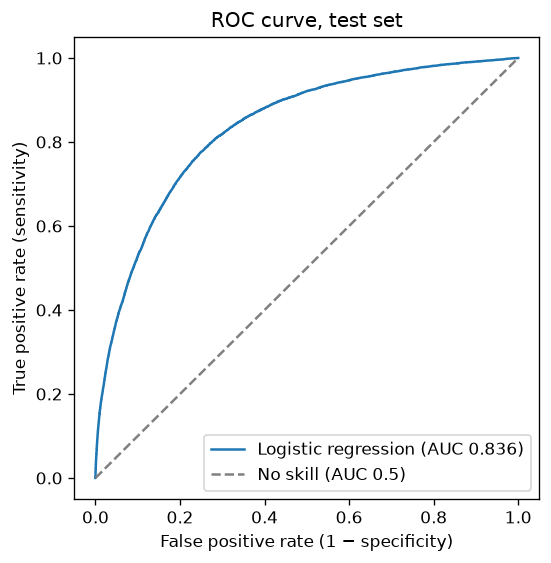
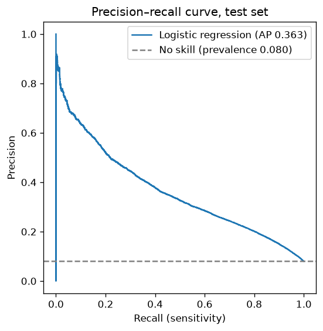

# Model evaluation report: Respiratory (reported COPD, emphysema or chronic bronchitis)

_Generated by `ml/training/train_binary_risk_model.py` on 2026-10-27 for model `respiratory_logreg_v1.joblib` (version 1.0.0). Every number below was computed by the training script; nothing is entered by hand. Re-running training regenerates this file._

## What the model estimates

Ever reported being told by a health professional that they had COPD, emphysema or chronic bronchitis (BRFSS CHCCOPD3). The model learns which combinations of answers go with **having reported** the condition in the survey. It does not predict whether a person will develop the condition, and it is not a diagnosis.

## Data and method

| Item | Value |
|---|---|
| Data | CDC BRFSS 2022, 2023, 2024 (pooled, complete cases) |
| Rows | train 789,054 · validation 169,083 · test 169,083 (stratified by outcome and year, seed 42) |
| Outcome rate in training data | 7.98% (unweighted sample) |
| Weighted US adult estimate | 6.42% (CDC survey weights, all respondents with a valid answer) |
| Features | age_group, sex, bmi, smoking_status, ecigarette_current_use, physical_activity_past_30_days, diabetes_status, asthma_status |
| Algorithm | Logistic regression (scikit-learn), unweighted |
| BMI form | spline (validation log loss: linear 0.21565, spline 0.21449; lower is better) |
| Calibration | none needed (validation before calibration: ECE 0.47%, slope 1.006) |

The test set was used once, after every choice (BMI form, calibration, threshold) had been made on the validation set.

## Results on the test set

| Metric | Model | Baseline: same estimate for everyone | What it means |
|---|---|---|---|
| ROC-AUC | 0.836 | 0.500 | Chance that a random person who reported the condition gets a higher estimate than a random person who did not |
| ROC-AUC, survey-weighted | 0.836 | 0.500 | The same, weighting respondents to represent US adults |
| PR-AUC (average precision) | 0.363 | 0.080 | Precision averaged over all recall levels; the baseline equals the outcome rate |
| Brier score | 0.0609 | 0.0735 | Mean squared error of the estimates (lower is better) |
| Log loss | 0.2163 | 0.2784 | Penalises confident wrong estimates (lower is better) |
| Expected calibration error | 0.47% | — | Average gap between estimate and observed rate across 10 groups |
| Calibration slope / intercept | 0.990 / -0.024 | — | 1 / 0 is perfect; slope below 1 means estimates are too spread out |

### At the reporting threshold (18.1%, chosen as maximum F1 on validation)

A threshold turns estimates into yes/no flags only so that standard metrics can be reported. **Vytal does not show users a yes/no result.**

| Metric | Value |
|---|---|
| Sensitivity (recall) | 49.7% of people who reported the condition were flagged |
| Specificity | 91.2% of people who did not were not flagged |
| Precision | 32.9% of flagged people had reported the condition |
| F1 | 0.396 |
| Share of people flagged | 12.1% |
| Accuracy (for reference only) | 87.9%; predicting "no" for everyone would score 92.0% |

Confusion matrix (test set):

| | Flagged | Not flagged |
|---|---|---|
| Reported the condition | 6,713 (true positive) | 6,787 (false negative) |
| Did not report it | 13,720 (false positive) | 141,863 (true negative) |

## Class imbalance

Only 8.0% of test respondents reported the condition. That is why accuracy is misleading (saying "no" to everyone is highly accurate) and why precision is modest at any useful sensitivity: even a good ranking flags many people who did not report the condition. The model was trained without class weighting so that its estimates stay on the true scale (D-009); imbalance only affects the reporting threshold.

## Calibration

| Group (by estimate) | People | Mean estimate | Observed rate |
|---|---|---|---|
| 1 | 16,909 | 0.41% | 0.75% |
| 2 | 16,909 | 0.71% | 0.93% |
| 3 | 16,909 | 1.43% | 1.32% |
| 4 | 16,908 | 2.23% | 1.75% |
| 5 | 16,908 | 3.00% | 2.63% |
| 6 | 16,908 | 4.17% | 3.78% |
| 7 | 16,908 | 6.55% | 6.16% |
| 8 | 16,908 | 9.81% | 10.34% |
| 9 | 16,908 | 15.72% | 16.81% |
| 10 | 16,908 | 36.14% | 35.38% |

  

## Presentation bands (what users see)

Bands describe where a person's estimate falls among the **training-set respondents**: Low = below the 50th percentile, Moderate = 50th–75th, Elevated = 75th–90th, High = 90th and above. They are **not clinical risk thresholds**. The table shows how often test-set respondents in each band actually reported the condition.

| Band | Estimate range | Share of test respondents | Observed rate in band | Mean estimate in band |
|---|---|---|---|---|
| Low | below 3.39% | 49.8% | 1.47% | 1.55% |
| Moderate | 3.39%–9.70% | 25.1% | 5.70% | 6.03% |
| Elevated | 9.70%–20.44% | 15.1% | 15.09% | 13.99% |
| High | 20.44% and above | 10.0% | 35.31% | 36.07% |

## Subgroup results (bias check, test set)

| Group | People | Outcome rate | Mean estimate | ROC-AUC | Sensitivity | Specificity | Calibration error |
|---|---|---|---|---|---|---|---|
| sex: female | 86,040 | 8.8% | 8.9% | 0.836 | 54.3% | 89.6% | 0.48% |
| sex: male | 83,043 | 7.2% | 7.1% | 0.834 | 43.9% | 92.8% | 0.46% |
| age: 18-44 | 50,436 | 2.5% | 2.4% | 0.770 | 17.0% | 98.5% | 0.53% |
| age: 45-64 | 53,840 | 7.9% | 8.1% | 0.840 | 50.2% | 91.6% | 0.40% |
| age: 65+ | 64,807 | 12.4% | 12.3% | 0.794 | 54.5% | 84.5% | 0.95% |
| survey_year: 2022 | 55,392 | 8.1% | 8.0% | 0.835 | 49.2% | 91.3% | 0.39% |
| survey_year: 2023 | 55,722 | 7.7% | 7.9% | 0.836 | 49.4% | 91.3% | 0.60% |
| survey_year: 2024 | 57,969 | 8.1% | 8.1% | 0.836 | 50.5% | 90.9% | 0.46% |

ROC-AUC within an age group is lower than overall because age itself is a strong signal; within a group the model must rely on the other answers. Sensitivity differs by group mainly because outcome rates differ (one threshold flags more people in higher-rate groups).

## Which answers matter most (test set)

Mean absolute contribution to the log-odds score per person, using the same method as the explanations shown to users. This is association within this model, not cause.

| Feature | Mean absolute contribution |
|---|---|
| Age | 0.758 |
| Cigarette smoking | 0.727 |
| Asthma | 0.408 |
| Any physical activity or exercise outside work in the past 30 days | 0.208 |
| Body mass index (from height and weight) | 0.141 |
| Ever told by a health professional that you have diabetes | 0.088 |
| Sex | 0.036 |
| Current e-cigarette or vape use | 0.027 |

## Robustness checks (reported only)

| Check | ROC-AUC | PR-AUC | Brier | Calibration error |
|---|---|---|---|---|
| Deployed model, test set | 0.836 | 0.363 | 0.0609 | 0.47% |
| Trained on 2022–2023 only, tested on 2024 (57,969 rows) | 0.836 | 0.367 | 0.0617 | 0.48% |
| Gradient boosting comparison (not deployed) | 0.839 | 0.369 | 0.0605 | 0.10% |

Logistic regression is deployed because its per-answer explanations are exact and easy to check (D-008). The comparison shows how much accuracy, if any, that choice costs.

## Limitations

- Self-reported, "ever told" outcomes; undiagnosed people count as "no".
- Cross-sectional data: answers such as smoking may have changed after diagnosis. Associations, not causes.
- US adults in a telephone survey; may not transfer to other populations.
- Complete-case data (about 15–19% of respondents excluded for unusable answers).
- Metrics treat respondents as independent and ignore the survey's strata and clusters.
- Not clinically validated; not for diagnosis or treatment decisions.
- The outcome groups COPD, emphysema and chronic bronchitis; asthma is an input, and some asthma may be misdiagnosed as COPD or vice versa.
